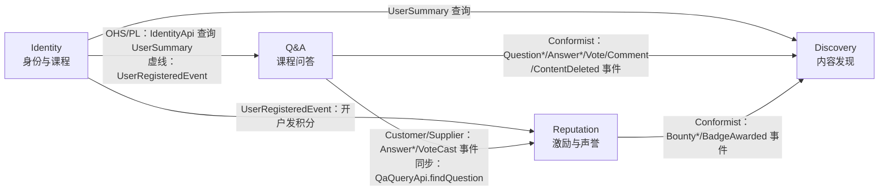

# 子域与上下文映射

## 1. 子域划分

| 子域 | 类型 | 对应上下文 | 判断依据 |
| --- | --- | --- | --- |
| 课程问答 | 核心域 | Q&A（`co-qa`） | 平台存在的理由；“只能采纳一次”“已删除不可回答”等规则最复杂，最体现差异化 |
| 激励与声誉 | 核心域 | Reputation（`co-reputation`） | 决定社区能否持续活跃；账本、悬赏、反作弊是本校定制的“游戏规则” |
| 身份与课程 | 支撑子域 | Identity（`co-identity`） | 必要但不独特；校园身份认证、课程成员关系是授权依据 |
| 内容发现 | 通用/支撑子域 | Discovery（`co-discovery`） | 搜索、推荐、通知是通用能力，可替换为 Elasticsearch 或独立服务（ADR-001 中的第一个拆分候选） |

## 2. 上下文映射图

箭头表示依赖方向（上游 → 下游）；实线为同步调用，虚线为异步集成事件。

## 3. 集成关系表

| 上游 → 下游 | 关系模式 | 集成方式 | 说明 |
| --- | --- | --- | --- |
| Identity → Q&A / Reputation / Discovery | 开放主机服务 + 发布语言（OHS/PL） | 同步查询 `IdentityApi`；异步 `UserRegisteredEvent` | 下游只拿到 `UserSummary`，不含学号、邮箱等个人信息 |
| Q&A → Reputation | 客户/供应商（Customer/Supplier） | 异步：`AnswerSubmitted` / `AnswerAccepted` / `AnswerEndorsed` / `VoteCast` 等事件；同步：`QaQueryApi.findQuestion` | Reputation 需要的事件字段（如 `questionAuthorId`）由 Q&A 在事件中提供 |
| Q&A → Discovery | 遵奉者（Conformist） | 异步：`Question*` / `Answer*` / `Vote` / `Comment` / `ContentDeleted` 事件 | Discovery 把事件折叠为自己的 `SearchDocument` 投影，模型以 Q&A 为准 |
| Reputation → Discovery | 遵奉者（Conformist） | 异步：`Bounty*` / `BadgeAwarded` 事件 | 用于“悬赏中”筛选与悬赏、徽章通知 |
| 全部上下文 | 共享内核（Shared Kernel） | Maven 依赖 `co-shared-kernel` | 修改共享内核须全组评审，影响所有上下文 |

## 4. 边界规则

1. **发布语言**：每个上下文只有一个 `*-api` 模块对外，内含查询接口、DTO 与集成事件；DTO 不暴露内部实体。
2. **禁止越界依赖**：`qa-application` 不得 import `reputation-domain`；ArchUnit 测试（`ArchitectureTest`）负责守住这条线。
3. **异步优先**：跨上下文的写操作一律通过集成事件，不做同步写调用；只有读场景允许同步查询。
4. **数据隔离**：表名前缀按上下文划分（`id_`、`qa_`、`rep_`、`dis_`），不得跨上下文直接查表。
5. **一致性**：跨上下文最终一致，事件由发件箱（outbox）投递，订阅方用 `ProcessedEventStore` 幂等消费。
